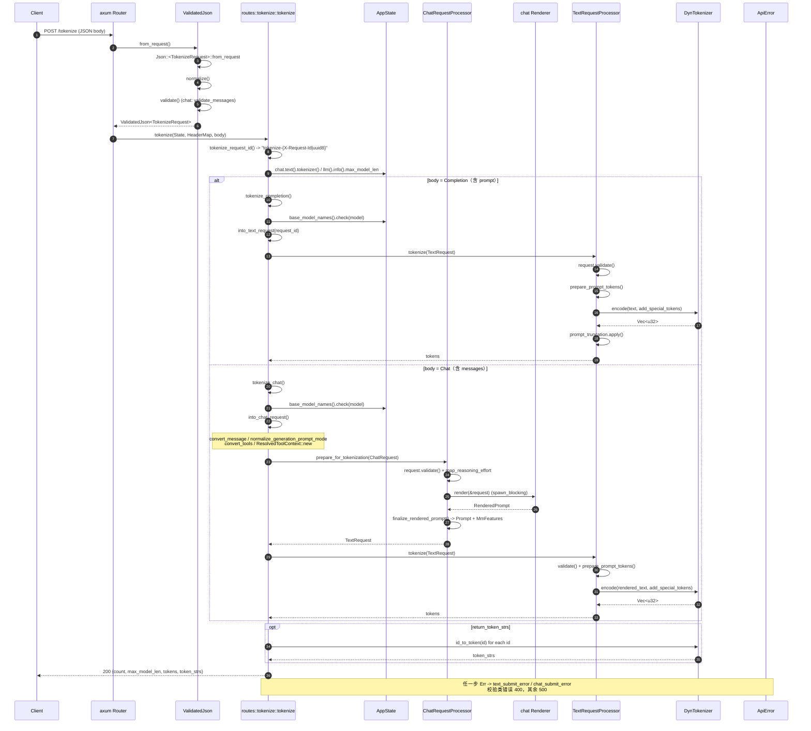
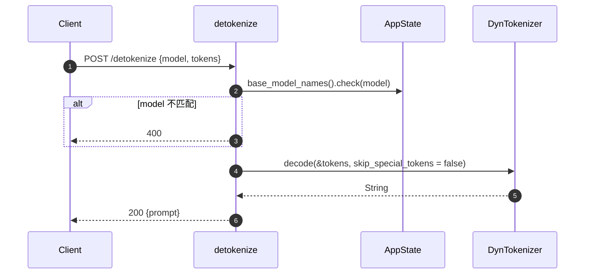
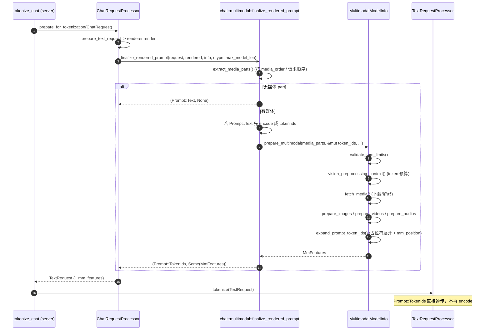

# `/tokenize` / `/detokenize` 调用时序

> 代码基线：Rust frontend（`rust/src/server`、`rust/src/chat`、`rust/src/text`、`rust/src/tokenizer`）。

## 0. 总览

`/tokenize` 与 `/detokenize` 是完全在进程内完成的纯 tokenizer 接口，不经过推理引擎
（`rust/src/server/src/routes/tokenize.rs:4-7`）。入口注册在 `routes.rs`：

```rust
.route("/tokenize", post(tokenize::tokenize))
.route("/detokenize", post(tokenize::detokenize));
```

分三层：

1. HTTP 适配层（`server` crate）
2. 请求预处理层（`chat` / `text` crate）
3. tokenizer 实现层（`tokenizer` crate）

## 1. `POST /tokenize` 时序图



### 每一步的作用

| # | 步骤 | 作用 |
|---|---|---|
| 1 | 路由分发 | axum 按 method + path 把请求交给 `tokenize::tokenize` |
| 2 | `ValidatedJson` 提取 | `Json<T>` 反序列化；`TokenizeRequest` 为 `#[serde(untagged)]`，有 `messages` 走 Chat 分支、有 `prompt` 走 Completion 分支（`routes/tokenize/types.rs:25-30`） |
| 3 | `normalize()` | 字段默认值 / 规格化钩子；tokenize 用默认 no-op |
| 4 | `validate()` | 校验 chat 的 `messages`（`validate_messages`），失败即 400 |
| 5 | `tokenize_request_id` | 生成 `tokenize-<X-Request-Id>`，无 header 则截断 UUID8，与 Python 前端一致（`routes/tokenize.rs:28-34`） |
| 6 | 取 tokenizer / `max_model_len` | `state.chat.text().tokenizer()` 克隆 `Arc<dyn Tokenizer>`；`max_model_len` 直接回填响应 |
| 7 | 模型名校验 | `base_model_names().check()`：请求里的 `model` 必须匹配已加载模型 |
| 8 | Completion 分支 | `into_text_request` 构造 `TextRequest`：`Prompt::Text(prompt)` + `add_special_tokens`，采样参数全默认（tokenize 不生成） |
| 9 | Chat 分支 lowering | `into_chat_request` 复用 chat completions 逻辑：消息转换、`add_generation_prompt` / `continue_final_message` 互斥校验、tool 解析；只设置影响渲染的字段 |
| 10 | `prepare_for_tokenization` | chat 专用：`validate` -> reasoning_effort 映射 -> 渲染，但不构造 output processor、不入引擎（`chat/src/lib.rs:276-281`） |
| 11 | `renderer.render` | 在 `spawn_blocking` 中执行 chat template（CPU/正则密集，避免阻塞 async runtime），产出拼接好的 prompt 文本 |
| 12 | `finalize_rendered_prompt` | 展开多模态占位符，返回 `Prompt` + 可选 `MmFeatures`；组装成 `TextRequest` 并打 `arrival_time` |
| 13 | `TextRequestProcessor::tokenize` | 统一入口：先 `validate()`（stop 串/约束等），再 `prepare_prompt_tokens`（`text/src/lib.rs:148-155`） |
| 14 | `prepare_prompt_tokens` | `Prompt::Text` -> `tokenizer.encode()`；`Prompt::TokenIds` 直接透传（benchmark 旁路）；随后按需做 prompt 截断（`text/src/lib.rs:108-125`） |
| 15 | `Tokenizer::encode` | trait 分发（`tokenizer/src/lib.rs:26-35`）：HF 后端优先 fastokens（`encode_with_special_tokens`），失败回退 HF `tokenizers`；另有 `TiktokenTokenizer` / `TekkenTokenizer`；`--skip-tokenizer-init` 时为 `UnavailableTokenizer` |
| 16 | `token_strs` | 仅当 `return_token_strs=true`，逐 id 调 `id_to_token`；未知 id 返回 `""`（对齐 Python `convert_ids_to_tokens`） |
| 17 | 组响应 | `count = tokens.len()`、`max_model_len`、`tokens`、`token_strs`（`None` 序列化为 `null`） |
| 18 | 错误映射 | `text_submit_error` / `chat_submit_error`：请求校验错误 -> 400，其余 -> 500（`server/src/error.rs:135-149`） |

关键分叉点：chat 请求多了一步「模板渲染 -> 文本」，completion 请求是原文直送 encoder；
两条路最后都汇聚到同一个 `TextRequestProcessor::tokenize` -> `DynTokenizer::encode`。

## 2. `POST /detokenize` 时序图



作用：模型名过滤 -> 直接调 `Tokenizer::decode`，固定 `skip_special_tokens=false`（与 Python 一致）
-> 包装成 `{prompt}`。这里不做 chat 模板反向解析，也没有引擎参与。

## 3. tokenizer 的来源（前置条件）

```rust
fn load_tokenizer(tokenizer: &TokenizerSource) -> Result<DynTokenizer> {
    match tokenizer {
        TokenizerSource::HuggingFace(path) => Ok(Arc::new(HuggingFaceTokenizer::new(path)?)),
        TokenizerSource::Tiktoken(path) => Ok(Arc::new(TiktokenTokenizer::new(path)?)),
        TokenizerSource::Tekken(path) => Ok(Arc::new(TekkenTokenizer::new(path)?)),
    }
}
```

- `HuggingFaceTokenizer::new`：先试 `fastokens::Tokenizer::from_json`（性能更好），失败回退
  HF `tokenizers`（`tokenizer/src/hf.rs:261-273`），并主动清掉 `tokenizer.json` 里的
  truncation / padding，避免出现 Python 前端看不到的行为差异。
- 无 tokenizer（`--skip-tokenizer-init`）-> `UnavailableTokenizer`，`has_tokenizer() = false`，
  此时只接受预 tokenize 的输入。
- `state.chat.text().tokenizer()` 只是 `Arc<dyn Tokenizer>` 的克隆（`text/src/lib.rs:92-95`），
  无锁、无 IO，因此 `/tokenize` 是纯 CPU 路径。

## 4. 客户端侧（bench）

`rust/src/bench/src/tokenizer.rs` 中的 `ServerTokenizer` 是这些接口的调用方，用于 bench 本地无
`tokenizer.json` 时的兜底：

- `encode_async`：`POST {base_url}/tokenize`，只带 `model` + `prompt`，不请求 `token_strs`，
  从响应取 `tokens` 数组；
- `decode_async`：`POST {base_url}/detokenize`，从响应取 `prompt`；
- 加载优先级：内置 tiktoken -> 本地 / HF `tokenizer.json` -> tiktoken 模型文件 -> 服务端 `/tokenize`。

## 5. 多模态在 `/tokenize` 中的处理位置

### 5.1 结论

`/tokenize` 的多模态处理只发生在 chat 分支（`messages`）。completion 分支（`prompt` 字符串）
完全不涉及多模态：即使字符串里写了 `<|image_pad|>`，也只是当普通文本编码。

主实现位于 `rust/src/chat/src/multimodal.rs`。

### 5.2 调用链



### 5.3 各段位置与职责

| 位置 | 职责 |
|---|---|
| `routes/tokenize.rs:100-105` | chat 请求走 `prepare_for_tokenization`（而非完整 `prepare`，因此不建 output processor、不入引擎） |
| `chat/src/lib.rs:227-273` `prepare_text_request` | 渲染模板，拿 `RenderedPrompt`（含 `media_order`），组装 `TextRequest` |
| `chat/src/lib.rs:173-196` `finalize_rendered_prompt` | 按 `model_dtype` / 是否有多媒体决定是否走 MM 分支；`None + 有媒体` -> `UnsupportedMultimodalRenderer` |
| `chat/src/multimodal.rs:634-665` | MM 主入口：抽媒体 part -> 若 `Prompt::Text` 先 `encode` -> `prepare_multimodal` -> 返回 `Prompt::TokenIds` + `MmFeatures` |
| `multimodal.rs:668-753` `extract_media_parts` | 从 `ChatContentPart` 取 `image_url` / `video_url` / `input_audio` / `audio_url`；有 `media_order` 时严格按渲染器报告的占位符顺序取，否则按消息 / content-part 顺序 |
| `multimodal.rs:857-950` `prepare_multimodal_timed` | 全流程编排：`limit-mm-per-prompt` 校验 -> 视觉 token 预算 -> `fetch_media`（`AsyncMultiModalTracker` + `MediaConnector`）-> 各模态 preprocess -> 占位符展开 -> 组装 `MmFeatureSpec` 并按 `mm_position.offset` 排序 |
| `multimodal.rs:976-1039` `fetch_media` | 真正下载 / 解码图片、视频抽帧、音频解码，并按模态分组保留 uuid |
| `multimodal/expand.rs:57-120` `expand_prompt_token_ids` | 把渲染出的占位符 marker（如 `<\|image_pad\|>`）原地替换为模型 spec 声明的长 token 序列，同时记录每项的 `PlaceholderRange` 和 `is_embed` mask |
| `chat/src/backend/hf.rs:57-70` | 加载期用 `MultimodalModelInfo::from_paths` 解析 `config.json` / `preprocessor_config.json` / `processor_config.json`，注册模型 spec、各模态 preprocessor、占位符 token；不支持则为 `None` |

### 5.4 容易踩的点

1. `/tokenize` 返回的 `tokens` 已包含展开后的占位符。一张图会被展开成几百个 `image_pad`，
   `count` 会远大于文本 token 数 —— 这正是该接口在多模态场景下的主要用途（拿准确长度）。
2. `MmFeatures` 被丢弃。`chat/src/lib.rs:279` 是
   `let (text_request, _) = self.prepare_text_request(request).await?;`，tensor payload 直接扔掉；
   但预处理仍完整执行（含 HTTP 下载、图像 resize、视频抽帧），只为算出占位符长度。对走远端
   图片的场景，`/tokenize` 的代价接近一次真实请求。
3. 不会重复 tokenize。多模态路径在 `finalize_rendered_prompt` 内部就 encode 好并改成
   `Prompt::TokenIds`，之后 `TextRequestProcessor::prepare_prompt_tokens`
   （`text/src/lib.rs:115-120`）对 `TokenIds` 直接透传；纯文本 chat 才是留到 `tokenize()` 里 encode。
4. 错误全是 400：`UnsupportedMultimodalRenderer`、`UnsupportedModality`、`MmLimitExceeded`、
   占位符数量 / 结构不匹配（`bail_multimodal!`）都在 `is_request_validation_error()` 白名单里
   （`chat/src/error.rs:122-143`）。
5. 不支持 `documents` 类输入：`routes/tokenize/types.rs:129` 里 `documents: None`，只有 message
   content 里的 image / video / audio part 能进 MM 流程。

